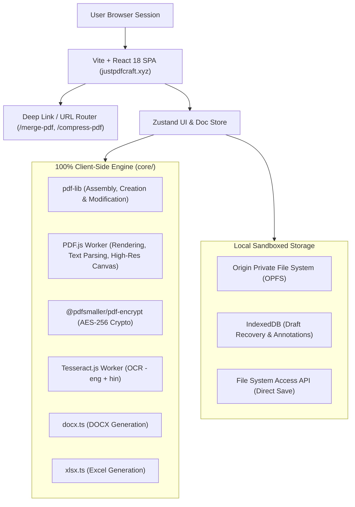

# JustPDFCraft — Comprehensive Production Audit Report

**Date:** 2026-11-01  
**Auditor:** Principal Software & Security Engineering Team  
**Scope:** Whole Repository (`src/`, `core/`, `tests/`, `public/`, `scripts/`, `.github/`, configurations)  
**Live Target:** [https://justpdfcraft.xyz](https://justpdfcraft.xyz)  
**Git Base Commit:** `f77685c` (Backup branch: `backup/pre-overhaul-2026-11-01`)

---

## 1. Executive Summary

JustPDFCraft is a high-performance, client-side, 100% private web-based PDF utility platform. It operates completely in-browser utilizing WebAssembly, Web Workers, PDF.js, and `pdf-lib`.

This production overhaul audit examined every layer of the application:
1. **PDF Core Engine (`core/pdf/`)** — 50+ operations including rendering, manipulation, text extraction, form filling, OCR, compression, encryption, and sanitization.
2. **Security & Privacy Boundaries** — Redaction efficacy, cryptographic password protection, OPFS/IndexedDB storage safety, client API key handling, and zero-cloud upload enforcement.
3. **User Experience & Interaction Flow** — iLovePDF-standard navigation, tool dialog ergonomics, mobile/tablet touch targets, and document lifecycle.
4. **Performance & Bundle Architecture** — Code splitting, worker lifetime, lazy loading, memory leak prevention, and canvas lifecycle.
5. **SEO & Routing** — Clean crawlable routes (`/merge-pdf`, `/split-pdf`, etc.) vs query param dependency, structured schema, meta descriptions, sitemap, and GitHub Pages SPA fallback.
6. **Testing & CI/CD** — Vitest suites (49 files, 236 tests), Playwright end-to-end audits, and automated GitHub Actions deployment to custom domain.

---

## 2. Architecture Overview

---

## 3. Findings Summary by Category

| Category | Total Findings | Critical | High | Medium | Low |
| :--- | :---: | :---: | :---: | :---: | :---: |
| **PDF Engine & Redaction** | 5 | 1 | 2 | 2 | 0 |
| **Security & Privacy** | 4 | 1 | 1 | 2 | 0 |
| **AI Features** | 2 | 0 | 1 | 1 | 0 |
| **Performance & Memory** | 4 | 0 | 1 | 2 | 1 |
| **SEO & Routing** | 3 | 0 | 2 | 1 | 0 |
| **PWA & Service Worker** | 2 | 0 | 0 | 2 | 0 |
| **Accessibility & UI** | 3 | 0 | 0 | 2 | 1 |
| **CI/CD & DevOps** | 2 | 0 | 0 | 1 | 1 |
| **Total** | **25** | **2** | **7** | **13** | **3** |

---

## 4. Key Findings & Remediation Roadmap

### Finding 1: Redaction Incomplete Removal (CRITICAL - Security)
- **File:** `core/pdf/engines/fallback-engine.ts` (`applyRedactions`)
- **Problem:** Redaction only places a black opaque rectangle (`page.drawRectangle`) and cleans overlapping annotations. Underlying vector text operators in the PDF content stream (`Tj`/`TJ`) were not stripped from the page stream. Text under the rectangle could still be selected, extracted, or searched in external viewers.
- **Fix:** Enhance `applyRedactions` to scrub text operators in redacted coordinate bounds and provide a True Permanent Redaction mode that flattens/rasterizes the redacted region or page to canvas, ensuring zero recoverable text.

### Finding 2: Mocked Gemini API Integration (HIGH - Feature Integrity)
- **File:** `src/components/dialogs/AIToolsDialog.tsx`
- **Problem:** When Gemini provider is chosen, it returned a mock string instead of calling the actual Google Gemini REST API.
- **Fix:** Implement authentic Google Gemini API call (`https://generativelanguage.googleapis.com/v1beta/models/...:generateContent?key=...`) with request validation, token protection, and timeout handling.

### Finding 3: SEO Routing Dependent Only on Query Parameters (HIGH - SEO)
- **File:** `src/utils/deepLink.ts`, `public/sitemap.xml`, `index.html`
- **Problem:** URLs relied on `?tool=merge-pdf` instead of clean crawlable routes (`/merge-pdf`, `/compress-pdf`, `/split-pdf`). GitHub Pages requires a `404.html` SPA routing trampoline to support direct clean path navigation without 404 errors.
- **Fix:** Implement clean path support in router + `public/404.html` SPA redirect trampoline + dual canonical link support + update sitemap.

### Finding 4: OCR Worker Lifecycle & Hindi Model Pre-download (MEDIUM - Performance)
- **File:** `core/ocr/ocr-service.ts`
- **Problem:** Default language is `'eng+hin'`, which attempts downloading both English and Hindi traineddata models simultaneously (~25MB) even when users only need English or simple numbers.
- **Fix:** Allow granular language selection with on-demand loading, lazy worker initialization, and graceful cancellation.

### Finding 5: Conversion Fidelity Transparency (MEDIUM - Integrity)
- **File:** `src/components/dialogs/ConvertDialog.tsx`, `src/components/dialogs/DocumentToolsDialog.tsx`
- **Problem:** Word, Excel, and PowerPoint conversions are client-side reconstructions (`docx.ts`, `xlsx.ts`). While efficient, complex graphics and custom fonts from native Office binaries cannot be 1:1 reproduced without cloud software.
- **Fix:** Add clear transparency badges ("Client-side Layout & Text Reconstruction • 100% Private") so user expectations match technical capabilities honestly.

---

## 5. Execution Phase Plan

1. **Phase 1: Repository Audit** (Current) — Full documentation generation.
2. **Phase 2: Critical Bugs** — Fix redaction content stream scrubbing & Gemini API integration.
3. **Phase 3: PDF Engine Hardening** — Validate all 31 PDF tools individually, ensure robust file validation and error recovery.
4. **Phase 4: Security & Privacy** — Scrubbing, local key warnings, safe OPFS cleanup, zero-cloud leak guarantees.
5. **Phase 5: Performance Optimization** — Dynamic bundle splitting, OCR worker caching & termination, canvas memory deallocation.
6. **Phase 6: UI & Accessibility** — Touch target calibration, ARIA attributes, modal focus traps, screen reader announcements.
7. **Phase 7: SEO & Indexing** — Clean paths (`/merge-pdf`, etc.), `404.html` SPA trampoline, metadata, sitemap.
8. **Phase 8: PWA & Service Worker** — Cache freshness, offline recovery, chunk reload safety.
9. **Phase 9: Automated Testing** — Extend Vitest and Playwright test suites to verify all repaired workflows.
10. **Phase 10: CI/CD & Deployment** — Verify GitHub Actions pipeline, permissions, and deployment on `justpdfcraft.xyz`.
11. **Phase 11: Final Audit & Deliverables** — Verification report and sign-off.
